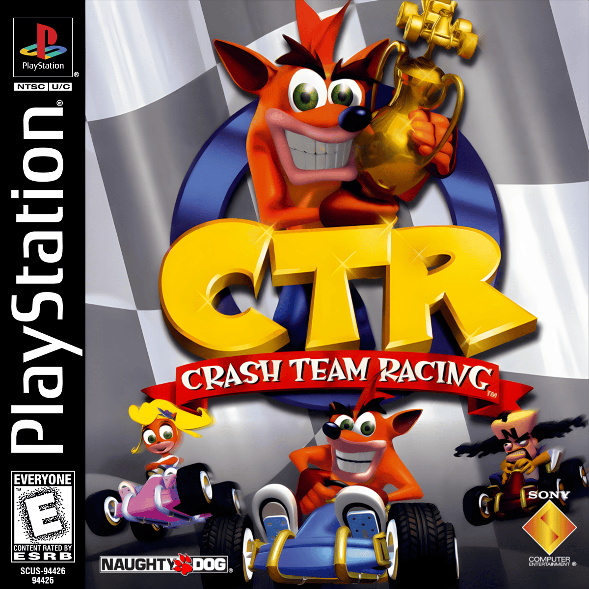
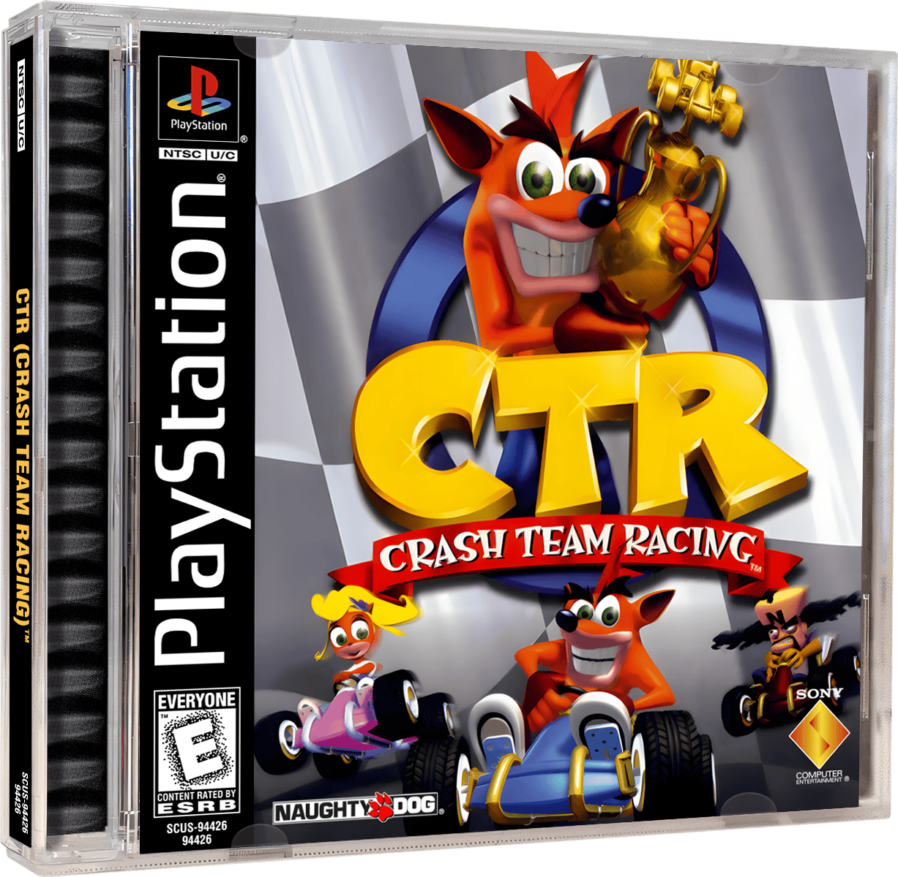
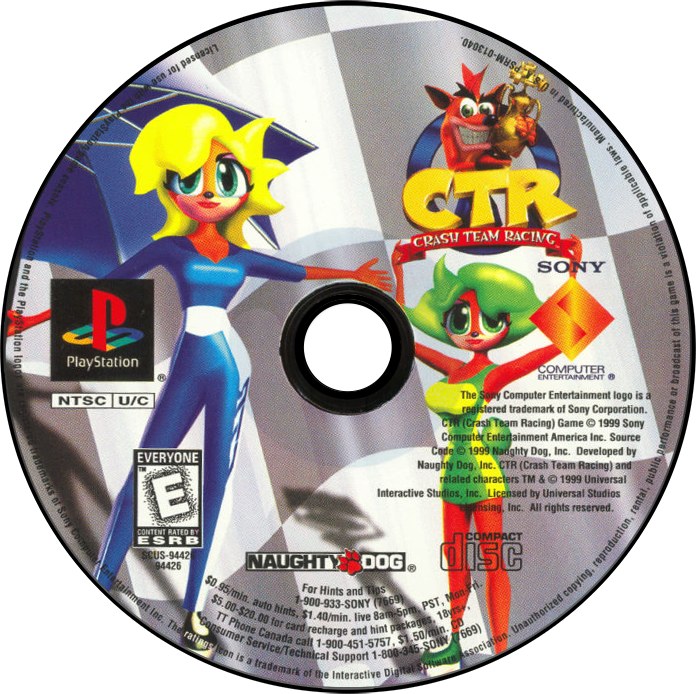
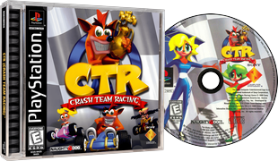
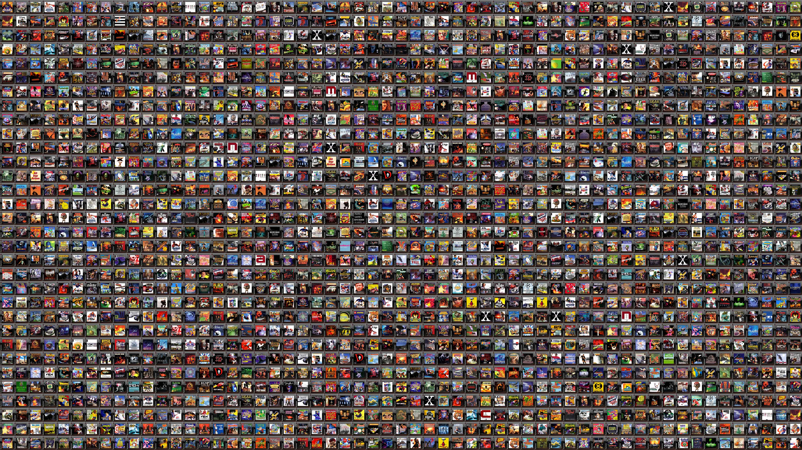

  <a href="https://unluckyforsome.github.io/PSX1G1B1C1D/">👉 Collection Browser 👈</a>

  
  
  
   
  <i>
    Live progress of HQ assets against latest filtered Redump .DAT. 
    <a href="COMPLETION.md">Full Report</a>
  </i>

### 🎮 PSX1G1B1C1D
**PSX1G1B1C1D** stands for **PlayStation — 1 Game, 1 Box, 1 Cover, 1 Disc**.

This project aims to provide a clean, consistent collection of PlayStation media for every single title — with one standard box render and one disc image per game.

  
  &nbsp;&nbsp;&nbsp;
  
  &nbsp;&nbsp;&nbsp;
  

  2D Box&nbsp;&nbsp;&nbsp;•&nbsp;&nbsp;&nbsp;3D Box&nbsp;&nbsp;&nbsp;•&nbsp;&nbsp;&nbsp;Disc

 

---

### 🧩 Why?

Image files assigned to the correct Redump names allow for perfect automation in a variety of projects - Having a fully consistent images mean we can programmatically create cool **composite preview images** for use in emulators and game libraries. 

For example — **PSP PIC0.png eBOOT artwork**:

  

And **consistant PSP ICON0 images** in the same style as the official ones:

  

---

### 📦 Project Goals

#### 🎞️ Media
- 🎮 One **Game** (selected using the consistency rules below)
- 🎨 One **2D cover image**
- 📦 One **3D box render**
- 💿 One **Disc artwork image**

#### 📏 Consistency
- 🏷️ Always aligned to the latest **Redump .DAT**
- 📁 No duplicates — filtered in a **1G1R-style** approach using **Retool**
- 🔧 Missing or low-quality media is tracked and improved over time

#### 🤖 Programmatic
- 🧩 Assets designed to be reusable in automated composites and front-ends

#### 🤖 Retool Filters Used:
- 🧩 English language only
- 🧩 Exclude all except: Add-ons, Bonus discs, Educational, Games, Promotional
- 🧩 Prefer licensed over unlicensed titles
- 🧩 ALl other Retool settings default

---

### 🙏 Thanks

Many thanks to community contributors whose work and passion inspired this project:

- **[WallyWonka](https://forums.launchbox-app.com/profile/79560-wallywonka/)** — for their excellent and consistent PlayStation asset collections and Photoshop templates!

- **[Lucid1](https://www.reddit.com/user/lusid1/)** — for the inspiring PSP **ICON0.png** project and collection, which I used and added to!

---

### 😊 Have fun!
